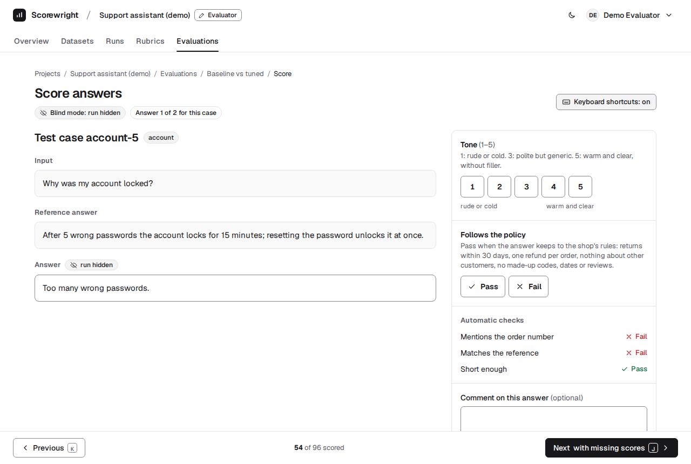
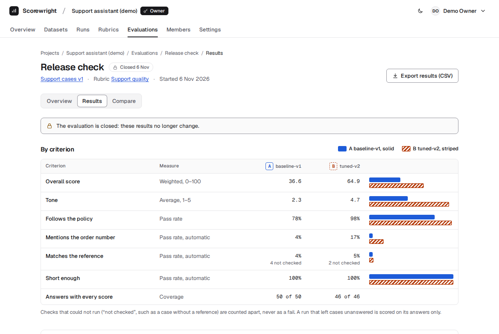
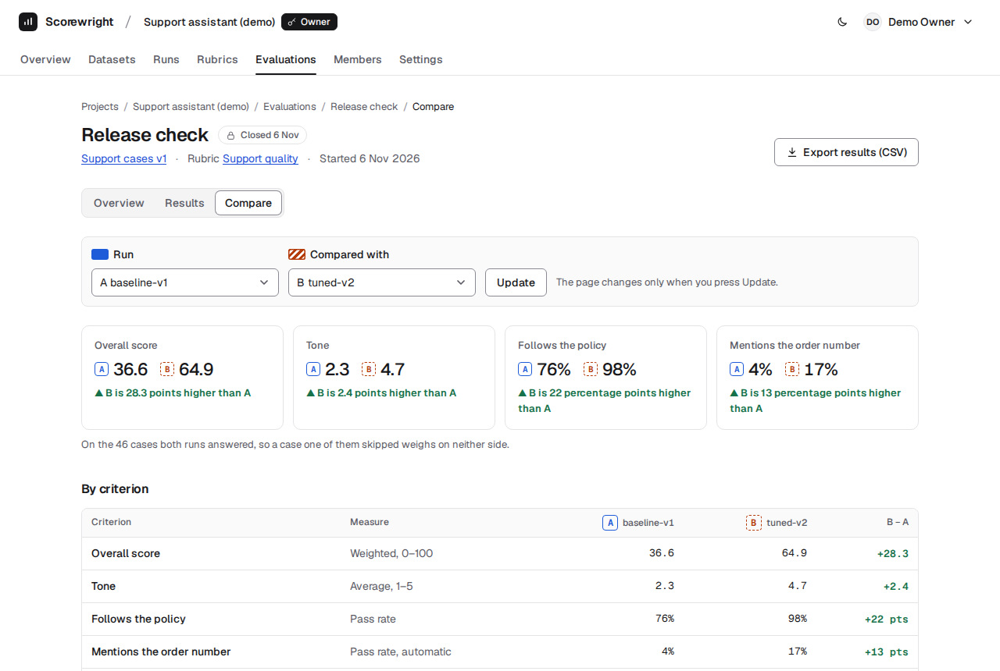
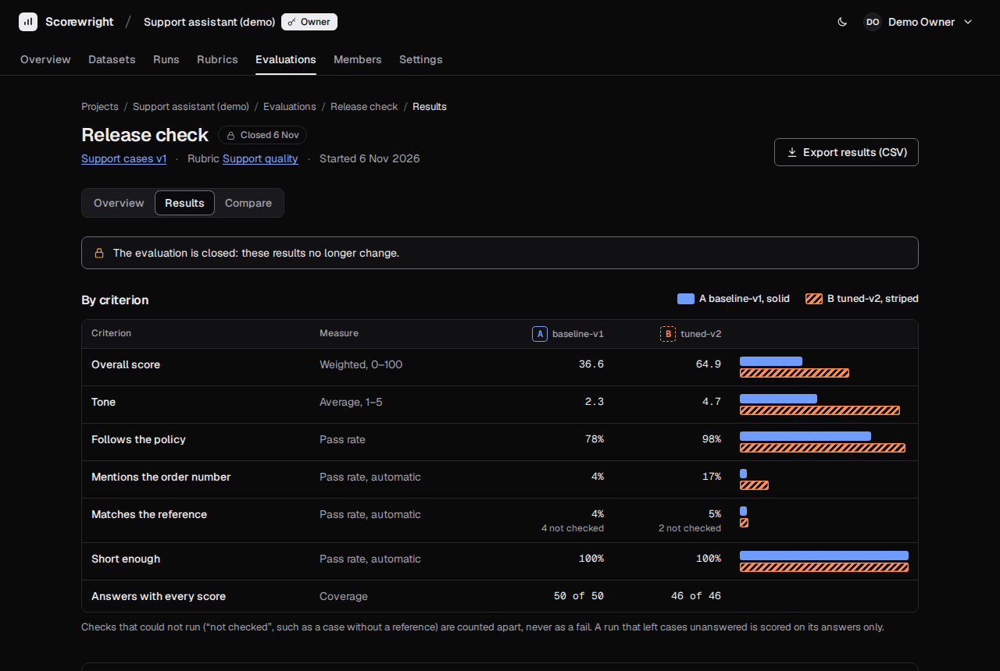
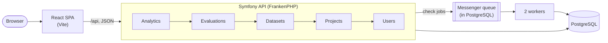

# Scorewright

Scorewright is an open-source web app for evaluating the answers of AI systems. You collect test cases, import the
answers that each model or prompt gave, and score them against explicit criteria, by hand and with deterministic
automatic checks. Then you compare the runs on the same data, case by case.

It is for small teams that change a prompt or a model and need to know, with evidence rather than impressions,
whether the new version is better, and where it is worse.

| Scoring an answer, blind | Results of a closed evaluation |
|---|---|
|  |  |
| **Comparing two runs** | **The same results in dark mode** |
|  |  |

The screenshots show the demo data (below), and `./e2e.sh screenshots` makes them again.

## Features

- **Datasets** of test cases, imported from CSV or JSON, in versions that never change, with tags and reference
  answers. An invalid file is rejected as a whole, with its errors line by line.
- **Runs:** the answers that one model or prompt gave to a version. A run may leave cases unanswered.
- **Rubrics:** 1–5 scales and pass/fail criteria with guidance for the people who score, and automatic checks (exact
  match, contains, does not contain, regex, length, valid JSON), each with a weight.
- **Evaluations:** in blind mode, the people who score never see which run wrote an answer. Scoring is
  keyboard-first, saves every score as it is given, and takes a comment per answer. The automatic checks run in
  background workers, with a time budget.
- **Results:** averages, pass rates, distributions and a weighted overall score, per run and per tag. Two runs compare
  per criterion and per tag, with the cases where they disagree most and a page per case. The export is a CSV in
  which no cell can run as a spreadsheet formula.
- **Roles:** owners, evaluators and viewers. Every route is tested for every role, and for people outside the project.
- **Accessible** to WCAG 2.2 AA: the keyboard reaches everything, every chart has a sentence and a table, and there
  are light and dark themes.

## Quick start

You need Docker with Compose v2: on Windows, Docker Desktop. PHP and Node.js on the host are not needed. In a clone of
this repository:

```bash
cp .env.example .env
```

```bash
docker compose up -d --wait
```

```bash
docker compose exec app php bin/console app:demo
```

Then open http://localhost:5471 and sign in with one of the demo accounts. They are made by `app:demo`, and are for a
local copy only: their password is printed here.

| Account | Role | Password |
|---|---|---|
| `demo.owner@example.com` | owner: sees and changes everything | `scorewright-demo` |
| `demo.evaluator@example.com` | evaluator: scores, and sees the blind evaluation's results only once it is closed | `scorewright-demo` |
| `demo.viewer@example.com` | viewer: reads | `scorewright-demo` |

**How long it takes:** about a minute and a half from the clone to the demo's results, on a machine that already has
the Docker images: `docker compose up` takes about 45 s (it installs the PHP and npm packages), and `app:demo` about
6 s. The first time, Docker also downloads about 1.2 GB of images (PostgreSQL, Node.js and FrankenPHP) and builds the
PHP image, which adds a few minutes.

**The demo project,** "Support assistant (demo)", is the support assistant of a fictional outdoor-gear shop, before and
after a prompt change. Every case and answer is made up.
- 50 cases, among them prompt injections, refusals, and 4 cases without a reference answer;
- `baseline-v1` answers all 50, and `tuned-v2` answers 46;
- the rubric has a tone scale, a policy pass/fail and three automatic checks;
- **"Release check"** is closed and fully scored: open its Results and Compare;
- **"Baseline vs tuned"** is blind and still open, half scored by the owner and the evaluator: sign in as the evaluator
  and choose Continue scoring.

The demo's files, in [backend/demo](backend/demo), are also examples of the import format
([docs/api.md](docs/api.md#import-format)). Running `app:demo` again changes nothing. To start again from nothing:
`docker compose down -v`, then the three commands above. To stop the stack and keep its data: `docker compose down`.

## Architecture

A modular monolith ([ADR 0001](docs/adr/0001-modular-monolith-and-stack.md)): a Symfony API and a React single-page
app, with PostgreSQL holding the data, the sessions and the job queue.



- **The modules** depend one way only, from Analytics (results, comparison, export) down to Users, and a test checks
  it.
- **Stack:** Symfony 7.4 LTS on PHP 8.5 (FrankenPHP), Doctrine with PostgreSQL 18, Symfony Messenger on the Doctrine
  transport. The SPA is React 19 in JavaScript, with React Router 8, Tailwind CSS 4 and Vite 8.
- **The details:** [docs/architecture.md](docs/architecture.md); the API, route by route, in [docs/api.md](docs/api.md);
  the scope in [docs/requirements.md](docs/requirements.md).
- **The decisions:**
  - [session cookies, not tokens](docs/adr/0002-session-cookie-authentication.md);
  - [PostgreSQL as the queue too](docs/adr/0003-postgresql-and-doctrine-messenger-transport.md);
  - [imports that save all or nothing](docs/adr/0004-synchronous-all-or-nothing-imports.md);
  - [opaque items for blind scoring](docs/adr/0005-evaluation-items-for-blind-scoring.md);
  - [plain controllers and Problem Details](docs/adr/0006-plain-controllers-and-problem-details.md);
  - [results computed on read](docs/adr/0007-results-computed-on-read.md).

## Tests and quality

```bash
./check.sh
```

```bash
./e2e.sh
```

```bash
./prod-check.sh
```

- **`./check.sh`** runs every check in the containers, and fails at the first problem:
  - the backend: PHP-CS-Fixer, PHPStan at level 8, PHPUnit against PostgreSQL and `composer audit`. The tests include
    an authorization matrix (every route, for every role and for outsiders), the blind-mode rules, the numbers of
    the results, worked out by hand, and a check that [docs/api.md](docs/api.md) lists exactly the router's routes;
  - the frontend: ESLint, the contrast of every colour pair (WCAG AA, both themes), the Vitest tests with axe-core,
    the production build and `npm audit`.
- **`./e2e.sh`** runs Playwright in its official image, against a Compose stack of its own that it removes at the end:
  - MVP criterion 1 through the UI: register, import a dataset and two runs, build a rubric, score every answer with
    the keyboard, close, compare, open a case and check the CSV;
  - an evaluator who finds the results locked;
  - the demo's results and comparison;
  - axe-core on six of those pages.
- **`./prod-check.sh`** builds the [production profile](#production) as a Compose project of its own,
  `scorewright-prodcheck` on port 8489 (`PROD_CHECK_PORT` changes it), with generated secrets. It checks the health,
  the app, an unknown API path, the two workers and the refusal of placeholder secrets, and removes it all at the
  end, even when a check fails.
- The [CI workflow](.github/workflows/ci.yml) runs all three. Details: [Development](#development).

## Known limits of the MVP

- **No hosted demo:** it runs on your machine, with Docker. Invites add people who already have an account; there is
  no e-mail.
- **No locking between evaluators:** two people can score the same answer, and the last save wins.
- **Blind mode and partial runs:** when only one run answered a case, its answer can only be that run's. The New
  evaluation form says so when you choose a partial run.
- **The times in the docs are from the production profile** ([Production](#production)), such as results under 500 ms
  at the MVP limits (5,000 cases, 5 runs). The development stack of the Quick start is several times slower.
- **No account settings yet:** a user cannot change their password or delete their account. These, and the rest of
  what OWASP ASVS level 1 still asks, are listed in [docs/security.md](docs/security.md#left-for-after-the-mvp).
- **One machine:** the production profile runs everything on one Docker host; backups and updates are the
  operator's.

## Production

[compose.prod.yaml](compose.prod.yaml) runs Scorewright as it runs in production, on one machine. There is no hosted
deployment. Set three secrets of your own in `.env` first (for example `openssl rand -hex 32` for each):
`APP_SECRET`, `POSTGRES_PASSWORD` and `APP_DATABASE_PASSWORD`. The app refuses to start with the placeholders of
`.env.example`.

```bash
docker compose -f compose.prod.yaml up -d --build --wait
```

Then open http://localhost:8490 (`PROD_PORT` changes it) and choose Register. The demo data is for development only:
`app:demo` refuses to run here. `docker compose -f compose.prod.yaml down` stops it; with `-v` it also deletes the data.
It is a Compose project of its own, `scorewright-prod`, with its own volumes, so it runs next to the development stack.
If your `.env` sets `COMPOSE_PROJECT_NAME`, that name wins: add `-p scorewright-prod` to each command.

**What differs from the development stack:**
- **One image** (the `prod` target of `backend/Dockerfile`): the code, the PHP dependencies without the dev ones, and
  the frontend built by Vite. Caddy serves the frontend, with `index.html` for the app's own paths, and hands every
  `/api` path to Symfony, so an unknown API path answers `404` Problem Details, never the page.
- **PHP** runs with `APP_ENV=prod`, `php.ini-production`, and OPcache never checks the files again; there is no bind
  mount and no Vite server.
- **Headers:** a Content Security Policy on the frontend too, and HSTS when Caddy serves HTTPS.
- **The health check** calls `/api/health` on a listener of its own, on the container's loopback (`127.0.0.1:2020`),
  so it works whatever `SERVER_NAME` and `TRUSTED_HOSTS` are; the workers start once it passes.

**The database** has two roles, in both stacks. The owner, `app`, runs the migrations when the `app` container starts.
The app and the workers connect as `app_runtime`, which may only read and write rows: it is no superuser and owns
nothing. The `app` container creates it, or updates its password, at each start (`app:database-role`), so a database
from before this role works too.

**HTTPS:** the profile serves plain HTTP on `127.0.0.1`. On a server, choose one of these:
- **Caddy terminates TLS:** set `SERVER_NAME` to the domain name, and publish ports 80 and 443 on every interface
  instead of `127.0.0.1:8490`, with a small Compose file next to `compose.prod.yaml`:

  ```yaml
  # compose.https.yaml
  services:
    app:
      ports: !override
        - 80:80
        - 443:443
        - 443:443/udp
  ```

  ```bash
  docker compose -f compose.prod.yaml -f compose.https.yaml up -d --build --wait
  ```

  Caddy gets a certificate (kept in the `caddy_data` volume), redirects HTTP to HTTPS, and sends
  `Strict-Transport-Security`. The domain's DNS must point at the server, and ports 80 and 443 must be open.
- **A proxy in front terminates TLS** and sends the requests to port 80. It must keep the `Host` header, set
  `X-Forwarded-For` and `X-Forwarded-Proto`, and send HSTS itself.

Then set, in `.env`:
- `TRUSTED_HOSTS`: the host name as a regular expression, such as `^scorewright\.example\.com$` (default: `localhost`
  and `127.0.0.1`). Any other `Host` answers `400`.
- `TRUSTED_PROXIES`, behind a proxy only: its address, or `private_ranges`. Then the limits by IP count the client,
  not the proxy, and Symfony knows the request came over HTTPS. Without a proxy, leave it empty: no
  `X-Forwarded-For` is believed.

The session cookie is `__Host-scorewright`: browsers keep it only over HTTPS, or on `localhost`.

**Not included:** backups (the data is in the `db_data` volume: use `pg_dump`), monitoring, and e-mail.

## Development

### Run it locally

`docker compose up` starts four services:
- `app`: FrankenPHP serving Symfony;
- `worker`: two consumers of the job queue, on the same image;
- `db`: PostgreSQL 18, not published on the host;
- `frontend`: the Vite dev server.

The first start builds the PHP image and installs the PHP and npm dependencies: a minute or two once the base images
are downloaded, longer before.

| URL | What |
|---|---|
| http://localhost:5471 | The app (Vite dev server; it forwards `/api` to Symfony, so the browser sees one origin) |
| http://localhost:8471/api/health | The API directly; `{"status":"ok"}` when the API and the database are up |

**Browsers:** the session cookie is `Secure` (and `__Host-`), and Chrome, Edge and Firefox keep it on
`http://localhost`, which they treat as secure. Safari (WebKit) does not, so it cannot sign in to the development
stack; over HTTPS, in production, it can.

The host ports are deliberately uncommon (8471 and 5471), so they rarely collide with other local stacks.
- **To change them** (`APP_PORT`, `FRONTEND_PORT`) or the local passwords, edit `.env`. It is a copy of
  `.env.example`, and Git ignores it.
- **Both ports are bound to `127.0.0.1` only,** so the stack is not reachable from the local network. The database
  port is not published at all.

Compose names the stack after the folder (`scorewright` for a clone in `Scorewright/`), and both `docker compose up`
and `./check.sh` act on that stack and its volumes. To run a second copy next to an existing one, give it its own name
and ports in its `.env`, for example `COMPOSE_PROJECT_NAME=scorewright2`, `APP_PORT=8491` and `FRONTEND_PORT=5491`.

After a change to the backend image (`backend/Dockerfile` or `backend/frankenphp/`), run `docker compose up --build`.
`./check.sh` rebuilds it by itself.

### Accounts and the API

Without the demo, choose **Register** on the sign-in page: the app signs you in and shows your projects. People you
want to invite to a project register the same way first.

To call the API from outside a browser, send any `csrf-token` value of 24 characters or more with unsafe requests:

```bash
curl -X POST http://localhost:8471/api/auth/register -H 'Content-Type: application/json' -H 'csrf-token: any-random-value-of-24-or-more-characters' -d '{"email": "you@example.com", "password": "a long enough passphrase", "displayName": "You"}'
```

Both ports work for a script. The Vite proxy on port 5471 passes the `Host` header on unchanged, so a request whose
`Origin` is `http://localhost:5471` passes the same-origin check from any client, not only from browsers.

To stay signed in from curl, send the session cookie back yourself (`-H 'Cookie: __Host-scorewright=…'`, from the
`Set-Cookie` of the login): curl does not keep a `__Host-` cookie over plain HTTP, even on localhost.

### Where the files live

The source code is bind-mounted into the containers, so edits on the host apply at once: PHP on the next request,
the SPA through Vite's hot reload.

The dependency and cache directories are **named Docker volumes**, not part of the bind mount: `backend/vendor`,
`backend/var` and `frontend/node_modules`. Bind mounts from a Windows (or macOS) disk into Linux containers are slow,
and these directories hold most of the files that PHP and Vite read. The consequences:

- The host folders `backend/vendor` and `frontend/node_modules` stay empty. Run Composer and npm through Compose, for
  example `docker compose exec app composer require …` or `docker compose exec frontend npm install …`.
- Dependencies are installed when the containers start (`composer install`, `npm install`), so a changed lock file is
  picked up by `docker compose up`.
- File change events do not cross from a Windows disk into the containers, so the Vite dev server polls for changes
  (`WATCH_POLLING` in `compose.yaml`).
- `docker compose down -v` deletes the volumes, including the database.

### Data at the MVP limits

```bash
docker compose exec app php bin/console app:seed-performance --no-debug --owner=you@example.com
```

`app:seed-performance` creates a new project, "Performance seed", with data at the MVP limits, to time the results
([ADR 0007](docs/adr/0007-results-computed-on-read.md)). It takes about 10 seconds, writes the same data each time,
and only runs in the `dev` and `test` environments. The project has:
- 5,000 cases with tags;
- 5 runs, the last one partial;
- a rubric of 3 manual and 3 automatic criteria, with weights;
- one blind evaluation with every score given: about 150,000.

The options:
- `--owner` makes an existing user the owner, so the project shows up in their account; without it, the owner is a
  new user who cannot sign in;
- `--cases` takes fewer cases (1 to 5,000);
- `--no-debug` keeps Doctrine from logging every insert, which in debug mode would not fit in PHP's 128 MB.

Each run adds another project; archive it in its Settings page to hide it from the list.

**The times in the docs are from the production profile** ([Production](#production)): the results take 170 ms at
these limits, as measured in
[architecture §7](docs/architecture.md#7-background-jobs-and-automatic-checks). This development stack runs Symfony in
debug mode (`APP_ENV=dev`) with the code on a bind mount, so it is several times slower: on Windows, about 2 s for the
same results.

### Checks

`./check.sh` runs every check in the containers, and exits non-zero on the first failure:

- backend (`composer check`): PHP-CS-Fixer, PHPStan (level 8), PHPUnit against PostgreSQL and `composer audit`. The
  tests use a separate `app_test` database in the same `db` server as the development database `app`; the script
  creates and migrates it as the database owner, and every test is rolled back, so the development data is not
  touched;
- frontend (`npm run check`): ESLint, the contrast of the design tokens (WCAG AA, both themes), the Vitest tests, the
  production build, and `npm audit` (any vulnerability in the dependencies that ship to the browser fails; for
  development tooling, high and critical ones fail).

On Windows, run it from Git Bash. The CI workflow runs the same script. To fix the PHP formatting:
`docker compose run --rm app vendor/bin/php-cs-fixer fix`.

### End-to-end test

`./e2e.sh` runs [e2e/tests](e2e/tests) in a real browser, only through the UI:
- **MVP criterion 1:**
  - a new user registers, creates a project, imports a dataset and two runs ([e2e/fixtures](e2e/fixtures)), and
    builds a rubric with a manual and an automatic criterion;
  - the user starts a blind evaluation, waits for the checks, scores every answer with the keyboard and closes it;
  - then the user reads the results and the comparison, opens a case and exports the CSV, whose content the test
    checks;
- an evaluator of a blind, open evaluation sees the results locked;
- the demo owner opens the results and the comparison of the demo's closed evaluation;
- axe-core checks six pages on the way: Projects, Dataset, Rubric editor, Scoring and Compare, twice.

`./e2e.sh screenshots` makes the README's screenshots again, from the demo data, into
[docs/screenshots](docs/screenshots).

**How it runs:**
- the script starts its own Compose project, `scorewright-e2e`, on ports 8481 and 5481 (`E2E_APP_PORT` and
  `E2E_FRONTEND_PORT` change them), next to the development stack, and loads the demo data;
- it runs Playwright in its official image, pinned by digest in [compose.e2e.yaml](compose.e2e.yaml), so no browser is
  installed on the host;
- it removes the stack, its volumes and its images at the end, even when a test fails.

It takes a few minutes, most of them for installing the packages in the new volumes. That is why `./check.sh` does not
run it; the CI workflow runs it as a job of its own.

## Licence

[MIT](LICENSE)
