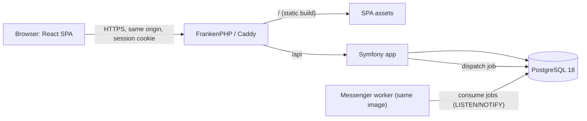
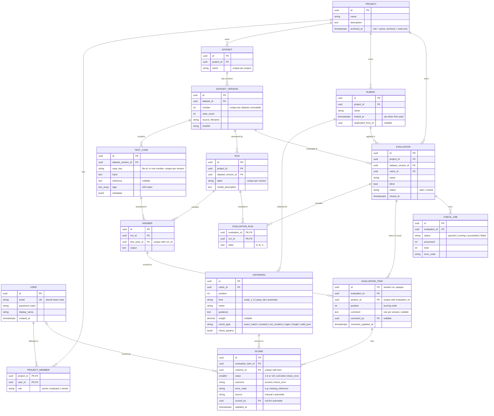

# Architecture

Status: **approved 2026-11-04** (TASK-020 to TASK-026), revised after the coherence review of requirements,
architecture and UX. Builds on [requirements.md](requirements.md) and the UX proposal (scoring, results and import
screens).

The product is called **Scorewright** (`APP_NAME=Scorewright`, used for the UI title). The code uses Symfony's default
`App\` namespace and generic names (`app` database), so a future rename only touches docs, the UI title and the
repository name.

## 1. Technology choices

Versions checked against the official sources on 2026-11-03 (frontend rows on 2026-11-04). Library versions not listed
here are pinned by `composer.lock` and `package-lock.json` when the project is created (TASK-027).

| Component | Choice | Why |
|---|---|---|
| PHP | **8.5** in Docker and CI; `"php": ">=8.4"` | 8.5 has active support until 2027-12-31 and security fixes until 2029-12-31. 8.3, named in the original plan, is already security-only. DoctrineBundle 3 and Migrations 4 require 8.4+. ([php.net](https://www.php.net/supported-versions.php)) |
| Backend framework | **Symfony 7.4 LTS** | Current LTS: bug fixes until Nov 2028, security fixes until Nov 2029; requires PHP 8.2+, and its CI tests PHP 8.5. Symfony 8.1 is newer but leaves maintenance in Jan 2027. Next upgrade target: the next LTS. ([symfony.com](https://symfony.com/releases)) |
| ORM | Doctrine ORM 3, DBAL 4, Doctrine Migrations | Symfony's default; migrations are versioned SQL. |
| Database | **PostgreSQL 18** | Supported until Nov 2030. JSONB, arrays, partial indexes and `LISTEN/NOTIFY` are used below. ([postgresql.org](https://www.postgresql.org/support/versioning/)) |
| Background jobs | **Symfony Messenger, Doctrine transport** | Uses PostgreSQL (with `LISTEN/NOTIFY`), so no extra service. Redis stays an option if throughput ever needs it. See [ADR 0003](adr/0003-postgresql-and-doctrine-messenger-transport.md). ([symfony.com](https://symfony.com/doc/7.4/messenger.html)) |
| Frontend | **React 19** (19.3 is current), **JavaScript**, **Tailwind CSS 4** (4.3, through `@tailwindcss/vite`), **Vite 8** (8.3), **React Router 8** (8.5) | Plain JavaScript (ES modules, JSX), no TypeScript: one developer must be able to explain every layer, and the API contract is enforced on the server (DTO validation, Problem Details) and by tests. Tailwind 4 needs no config file, only the Vite plugin and `@import "tailwindcss"`. See [ADR 0001](adr/0001-modular-monolith-and-stack.md). ([react.dev](https://react.dev/versions), [Tailwind releases](https://github.com/tailwindlabs/tailwindcss/releases), [vite.dev](https://vite.dev/releases), [React Router releases](https://github.com/remix-run/react-router/releases)) |
| Node.js (tooling only) | **26 LTS** | Active LTS since 2026-10-28; 24 is in maintenance. Vitest 5 and Vite 8 support it. |
| Runtime | FrankenPHP (Caddy) from the `dunglas/symfony-docker` template | One container serves the built SPA and `/api` from the same origin. |
| Tests and quality | PHPUnit, PHPStan, PHP-CS-Fixer; Vitest, Testing Library, Playwright with axe-core; ESLint | See §8. |
| CI | GitHub Actions | Prepared locally; it only runs after publication is approved. |

## 2. Logical architecture

A modular monolith: one Symfony application, one React single-page app and one PostgreSQL database
([ADR 0001](adr/0001-modular-monolith-and-stack.md)).



Docker Compose services: `app` (FrankenPHP), `worker` (same image, `messenger:consume async`) and `db` (PostgreSQL 18).
In development, a `frontend` service runs the Vite dev server and proxies `/api`, so the browser still sees one origin.
This avoids CORS altogether: cross-origin requests are not allowed.

## 3. Modules and boundaries

Each module is a directory under `backend/src/` with its entities, controllers, services and repositories.
Dependencies point one way only: `Analytics → Evaluations → Datasets → Projects → Users`.
A small PHPUnit architecture test fails if a module imports a PHP class from a module to its left.
Modules call each other through PHP services, never over HTTP.

| Module | Owns | Exposes to other modules |
|---|---|---|
| **Users** | `User`; registration, login/logout, password hashing, profile | user lookup by id or email |
| **Projects** | `Project`, `ProjectMember`, roles, archive state; `ProjectVoter`; the request listener that resolves the `{projectId}` route parameter and membership | `ProjectAccess` (current member, role, archived flag), voter attributes |
| **Datasets** | `Dataset`, `DatasetVersion`, `TestCase`, `Run`, `Answer`; CSV/JSON import parsing and validation | read access to versions, cases and answers; "is in use" checks |
| **Evaluations** | `Rubric`, `Criterion`, `Evaluation`, `EvaluationRun`, `EvaluationItem`, `Score`, `CheckJob`; manual scoring and comments; automatic checks (Messenger handler); **`EvaluationVoter`**, which holds the blind-mode and closed-evaluation rules on top of `ProjectAccess` | read models for progress and scores |
| **Analytics** | No entities. Read-only SQL queries (DBAL) for aggregates, comparison, disagreements and the CSV export | — |

- **Where the rules live:** project rules (membership, roles, archived) are in Projects. The rules that depend on an
  evaluation (blind mode, closed state) are in `EvaluationVoter`, so Projects never imports Evaluations.
- **Analytics** is the leftmost module. It reads the tables of the other modules directly with SQL, read-only, which
  the import-based architecture test cannot see. Its queries are reviewed in code review and covered by its own tests.

Frontend layout (`frontend/src/`): `routes/` (one folder per page in the UX page map), `components/`, and `api/`
(one small `fetch` client that sends the CSRF header and turns Problem Details responses into errors; no generated
types).
- Server state uses React Router loaders and actions. A data-fetching library is added only if a concrete need appears.
- UI preferences (theme, keyboard shortcuts on/off) are stored in the browser (`localStorage`), not in the database.

## 4. Data model

All tables have UUID primary keys (v7, time-ordered), except `evaluation_item`, which uses random v4 ids
([ADR 0005](adr/0005-evaluation-items-for-blind-scoring.md)).
Every top-level resource stores `project_id`, so every query can be scoped by project.



### Integrity rules

- **Case keys:** the dataset file has an optional `id` column (`id` field in JSON).
  - When present, it must be unique in the file.
  - When absent, `case_key` is the 1-based number of the data row (CSV, header not counted) or item (JSON).
  - Runs refer to cases by `case_key`. In a run, an unknown or duplicated `case_key` is an import error.
- **Immutability:**
  - A dataset version and its cases and answers are never updated; there are no update endpoints.
  - A rubric with `locked_at` set rejects edits with `409 rubric_locked`, but can be duplicated. `locked_at` is set in
    the same transaction that creates the first evaluation using the rubric, and stays set.
- **One score per item and criterion:** a unique index on (`evaluation_item_id`, `criterion_id`) makes scoring an
  idempotent upsert. The comment lives on the item, so an answer can be commented before or without any score.
- **One active check job per evaluation:** a partial unique index on `check_job (evaluation_id) WHERE status IN
  ('queued','running')`.
- **Same dataset version:** an evaluation's runs must belong to its dataset version, checked when the evaluation is
  created. Comparisons are between runs of the same evaluation.
- **At least one owner per project:** removing or demoting the last owner answers `409 last_owner`.
- **Deleting (owner only):**
  - Deleting an **evaluation** deletes its items, scores, comments and check jobs.
  - A **dataset** (with its versions, cases and runs), a **run** or a **rubric** can be deleted only when no
    evaluation uses it. Otherwise the answer is `409 in_use`, listing the evaluations to delete first.
- **Archiving:**
  - An archived project is read-only: every write answers `409 project_archived`, except `POST …/restore` by an owner.
  - It is hidden from `GET /api/projects` unless `?archived=true` is passed.

**Field limits** (configurable; each one has an import error code and a test fixture):

| Field | Limit |
|---|---|
| `id` / `case_key`, run label | 100 characters |
| `input`, `reference` | 20,000 characters |
| answer `output` | 50,000 characters |
| `tags` | 20 per case, 50 characters each |
| `metadata` | JSON object, 10 KB when encoded |
| model description | 2,000 characters |
| names (project, dataset, rubric, criterion, evaluation) | 200 characters |
| guidance, comment | 5,000 characters |

Indexes beyond the unique constraints: `test_case (dataset_version_id)`, GIN on `test_case.tags`,
`evaluation_item (evaluation_id, position)`, `score (criterion_id)`, `answer (test_case_id)`.

Sizes at the MVP limits: 5,000 cases × 5 runs = 25,000 answers, and with about 6 criteria 150,000 scores per
evaluation. That is small for PostgreSQL with these indexes.

## 5. REST API

Conventions:

- JSON over HTTPS under `/api`. Every project resource lives under `/api/projects/{projectId}/…`.
- Timestamps are ISO 8601 in UTC.
- Lists take `?page=` and `?perPage=` (default 25, max 100) and return `{ "items": [...], "page", "perPage", "total" }`.
- **Request bodies** map to DTOs (`#[MapRequestPayload]`) validated with Symfony Validator.
  - `#[MapRequestPayload]` ignores unknown fields by default. To reject them, the serializer's default context sets
    `allow_extra_attributes: false` (`framework.serializer.default_context`), so an unknown field answers `422`.
  - A test covers this.
- **Imports** are `multipart/form-data` with one file. Size is checked before parsing.
- Plain Symfony controllers, no API Platform ([ADR 0006](adr/0006-plain-controllers-and-problem-details.md)).

Prefix `P = /api/projects/{projectId}`. Roles: O = owner, E = evaluator, V = viewer.

| Area | Endpoints | Who |
|---|---|---|
| Auth | `POST /api/auth/register`, `POST /api/auth/login`, `POST /api/auth/logout`, `GET /api/me` | public / signed in |
| Projects | `GET`, `POST /api/projects` (`?archived=true` lists archived ones); `GET`, `PATCH P`; `POST P/archive`; `POST P/restore` | any user creates (and becomes owner); read O E V; edit, archive and restore O |
| Members | `GET`, `POST P/members` (`{email, role}`); `PATCH`, `DELETE P/members/{userId}` | O only |
| Datasets | `GET P/datasets`; `POST P/datasets` (multipart: `name` + file, creates the dataset and version 1); `GET`, `DELETE P/datasets/{id}`; `POST P/datasets/{id}/versions` (next version); `GET P/dataset-versions/{id}/cases?tag=&q=` | read O E V; write O |
| Runs | `GET P/runs?datasetVersion=`; `POST P/runs` (import); `GET`, `DELETE P/runs/{id}` | read O E V; write O |
| Rubrics | `GET`, `POST P/rubrics`; `GET`, `PUT`, `DELETE P/rubrics/{id}`; `POST P/rubrics/{id}/duplicate` | read O E V; write O |
| Evaluations | `GET`, `POST P/evaluations`; `GET`, `DELETE P/evaluations/{id}`; `POST …/close`; `POST …/automatic-checks` (re-run) | read O E V; write O |
| Scoring | `GET P/evaluations/{id}/items/next`; `GET …/items/{itemId}`; `PUT …/items/{itemId}/scores/{criterionId}` (`{value}`); `PUT …/items/{itemId}/comment` (`{comment}`; empty clears) | O E (open evaluations only) |
| Results | `GET P/evaluations/{id}/results`; `GET …/comparison?runA=&runB=`; `GET …/cases/{caseId}`; `GET …/export.csv` | O V; E too, except for a blind evaluation that is still open |

### Run data and blind mode

- `GET P/runs` and `GET P/runs/{id}` return run metadata only (label, model description, dataset version, answer
  count). **No endpoint lists a run's answers.**
- Answers are only returned by:
  - the scoring item endpoints, which never identify the run in a blind evaluation;
  - the result endpoints (`results`, `comparison`, `cases/{caseId}`, `export.csv`), which evaluators cannot read while
    a blind evaluation is open.
- `GET P/evaluations/{id}` lists the evaluation's runs (letter and label) and progress, but no answers.
- So nothing an evaluator can read links an answer's text to its run while a blind evaluation is open. §8 tests this
  for every evaluator-readable endpoint.

### Scoring

- `PUT …/scores/{criterionId}` and `PUT …/comment` are idempotent upserts, so sending them twice is harmless.
- Writing to a closed evaluation answers `409 evaluation_closed`.
- `items/next` returns the first item by `position` that still lacks a manual score for some criterion. The order is
  grouped by case; in blind mode, runs are shuffled within each case when the evaluation is created.
- **There is no locking between evaluators in the MVP.** Two evaluators can be given the same item, and for each
  criterion the last save wins (`scored_by` and `updated_at` record who and when). This is a documented limitation.
- If the rubric has no manual criteria, `items/next` answers `204` and progress is `{scored: 0, total: 0}`. Progress
  counts manual scores only; automatic checks report through the check job (§7).
- Item responses carry the item id, input, reference, answer text, criteria, existing scores, the comment and
  `{scored, total}` progress. **In blind mode they contain no run id, label or letter.**

### Errors

Every error is `application/problem+json` (RFC 9457) with a stable machine-readable `code`:

```json
{
  "type": "/problems/import-rejected",
  "title": "Import rejected: nothing was saved",
  "status": 422,
  "code": "import_rejected",
  "errorCount": 137,
  "affectedLines": 61,
  "errorCountsByCode": { "required": 12, "too_long": 120, "duplicate_case_key": 5 },
  "truncated": true,
  "errors": [
    { "line": 14, "field": "input", "code": "required", "message": "Input is empty. Add the prompt text in column \"input\".", "excerpt": "" }
  ]
}
```

- Validation errors use the same `errors` array, with `field` paths (`criteria[2].checkParams.pattern`).
- **Import errors** report:
  - `line` for CSV (the header is line 1) or `item` for JSON (1-based);
  - the `field` path, the `code`, and a `message` that says how to fix it;
  - an `excerpt` of at most 80 characters.
- **Truncation:** at most 100 errors are listed. `errorCount`, `affectedLines` (distinct lines or items with an error)
  and `errorCountsByCode` always describe the whole file, so the screen can show counts by type and "and N more errors
  of the same kinds".
- Excerpts appear only in this response, which only the importing member sees. They are never logged.

| Status | When |
|---|---|
| 400 | Malformed JSON or multipart |
| 401 | Not signed in |
| 403 | Member without the needed role, or an evaluator asking for the results of an open blind evaluation (`results_hidden_until_closed`) |
| 404 | Resource missing **or in a project the user is not a member of** |
| 409 | `rubric_locked`, `evaluation_closed`, `last_owner`, `in_use`, `project_archived`, duplicate run label, check job already active |
| 413 | Upload larger than the limit (5 MB by default) |
| 422 | Validation or import errors, including unknown request fields |
| 429 | Login or invite throttled |

## 6. Authentication and authorization

**Authentication** ([ADR 0002](adr/0002-session-cookie-authentication.md)):

- Session cookie, because the SPA is served from the same origin. Symfony `json_login` handles
  `/api/auth/login`; logout invalidates the session.
- The cookie is `HttpOnly`, `Secure`, `SameSite=Lax`. Sessions are stored in PostgreSQL (`PdoSessionHandler`), so a
  container restart does not sign everyone out.
- **CSRF:** unsafe methods (`POST`, `PUT`, `PATCH`, `DELETE`) must pass Symfony's stateless CSRF check (Origin/Referer
  against the app origin) and the double-submit `csrf-token` header (`check_header: true`), applied to the whole
  `/api` firewall. ([symfony.com](https://symfony.com/doc/7.4/security/csrf.html))
- Passwords use the framework's `auto` hasher. The minimum length is 12 characters, there is no maximum below 128, and
  there are no composition rules. There is no external breached-password lookup, because that would be a third-party
  call.
- Login throttling uses Symfony's `login_throttling` (rate limiter), keyed by email and IP.
- Registration is open. Invites only add users who already have an account (no email delivery in the MVP). The
  account page shows the profile from `GET /api/me` and a log-out button; profile editing is not in the MVP.

**Authorization** (per project):

1. A request listener loads the `{projectId}` route parameter and the caller's membership. If the caller is not a
   member, the answer is **404**, before any other lookup. If the project is archived, writes answer `409
   project_archived`.
2. `ProjectVoter` (Projects) decides the role-based actions; `EvaluationVoter` (Evaluations) adds the blind and closed
   rules:

| Action | Owner | Evaluator | Viewer |
|---|---|---|---|
| Read project content (datasets, cases, run metadata, rubrics, evaluations) | yes | yes | yes |
| Read members | yes | no | no |
| Read results of a non-blind or closed evaluation | yes | yes | yes |
| Read results of an open blind evaluation | yes | **no** | yes |
| Score and comment (open evaluations) | yes | yes | no |
| Import datasets and runs; create, edit or duplicate rubrics; create, close, re-check or delete evaluations | yes | no | no |
| Members, rename, archive, restore, delete | yes | no | no |

3. Repositories only expose project-scoped finders (`findInProject($projectId, $id)`), so a forgotten check still
   cannot reach another project's rows.

## 7. Background jobs and automatic checks

- Creating an evaluation, or `POST …/automatic-checks`, creates a `CHECK_JOB` and dispatches
  `RunAutomaticChecks(jobId)`. Messenger uses the Doctrine transport, `auto_setup: false` (the table comes from a
  migration), 3 retries with backoff, and a `failed` transport.
- The handler processes items in batches of 500 and upserts automatic scores, so a retry or re-run is idempotent. It
  updates `processed/total`, which the evaluation page polls every 5 s at most.
- The checks are pure functions over (answer, reference, params): exact match, contains, does not contain, regex,
  length limits and valid JSON.
  - `exact_match` on a case without a reference gives `outcome = check_error`, `error_code = missing_reference` and
    `value = null`. The results count these separately; they are not failures.
  - Regex patterns are validated when the rubric is saved (they must compile; max 500 characters).
  - At run time, a PCRE error such as the backtrack limit gives `check_error` (`regex_error`), not a crash. This guards
    against catastrophic backtracking.
- The worker runs `messenger:consume async --time-limit=3600 --memory-limit=256M` under Compose's restart policy.

**Results** are computed on read with SQL aggregates over `score`
([ADR 0007](adr/0007-results-computed-on-read.md)): averages and distributions per criterion and run, a breakdown by
tag, a per-case comparison and the cases with the largest disagreement. The CSV export streams the same queries.
Every cell starting with `=`, `+`, `-`, `@`, tab or carriage return is prefixed with `'` to neutralise formula
injection.

## 8. Testing strategy

| Level | Tool | What it must cover |
|---|---|---|
| Unit | PHPUnit | Import parser and validator (one fixture per error code and per field limit, both formats, generated `case_key`, UTF-8), each automatic check including `missing_reference` and a catastrophic-backtracking regex, score normalisation, CSV escaping. |
| Functional API | PHPUnit `WebTestCase` against **PostgreSQL** (Docker in local and CI), each test in a rolled-back transaction | Every endpoint's happy path and errors; all-or-nothing imports; rubric locking; closed evaluations; deletion rules (`in_use`); archived projects (`project_archived`, restore); unknown request fields → 422. |
| Authorization matrix | PHPUnit data provider | **Every route** × {anonymous, non-member, viewer, evaluator, owner} → expected status. For evaluation routes the matrix adds the **evaluation state** {not blind, blind and open, closed}. Scoring routes expect `409` on closed evaluations; result routes expect `403` for evaluators on blind and open ones. The test reads the router and fails if a new route has no matrix entry (MVP criterion 2). |
| Blind mode | PHPUnit | As an evaluator on a blind, open evaluation, call **every route the evaluator may read** and assert that no response pairs an answer's text with its run id, label or letter. |
| Architecture | PHPUnit | Module dependency direction (§3). |
| Frontend unit | Vitest and Testing Library | Scoring screen (shortcuts, ignored in text fields, autosave and Retry, comment), import-error summary and table, comparison table and chart alternative. |
| End to end | Playwright with axe-core | MVP acceptance flow 1 on the demo stack, plus automated WCAG checks on the scoring, results and import pages. |
| Static analysis | PHPStan (level 8 to start), PHP-CS-Fixer, ESLint for JavaScript and JSX (`@eslint/js` recommended rules plus the React Hooks plugin) | Run in CI and locally with one command. |
| Dependencies | `composer audit`, `npm audit --omit=dev` | CI. |
| Performance | `app:seed-performance` (5,000 cases × 5 runs, one evaluation with scores) and a command that times the list and results queries | Run before each release; target under 500 ms on a laptop. |

SQLite is not used for tests: the schema relies on PostgreSQL types (JSONB, arrays, partial indexes).

## 9. Security requirements

OWASP ASVS level 1 is the reference. The concrete rules for this project:

- **Access control:** deny by default, membership resolved before anything else, 404 for other projects, an
  authorization test for every endpoint and evaluation state (§6, §8).
- **Authentication and sessions:** §6. The session id is regenerated on login, and sessions expire after 8 h idle.
- **Account enumeration:** inviting an email without an account necessarily tells the owner that the account does not
  exist (invites only add existing users). This is accepted for the MVP. Invites are rate-limited per project and
  user (20 per hour), and only owners see member emails.
- **Input:**
  - DTO validation at the API boundary, unknown fields rejected.
  - Upload limits are checked in PHP and in the app (5 MB, 5,000 rows by default, configurable), plus the field limits in §4.
  - JSON parsing has a depth limit.
  - Uploaded files are parsed in memory, **never stored or served back** ([ADR 0004](adr/0004-synchronous-all-or-nothing-imports.md)).
- **Output:** React escapes text by default, and answers are rendered as text only (`pre-wrap`), never as HTML.
  CSV formula injection is neutralised.
- **Headers (Caddy):**
  - `Content-Security-Policy: default-src 'self'; frame-ancestors 'none'; object-src 'none'; base-uri 'self'`
  - `X-Content-Type-Options: nosniff`
  - `Referrer-Policy: same-origin`
  - HSTS when served over HTTPS
- **Privacy:** case contents, answers, comments and import excerpts never go into logs. A Monolog processor drops
  request bodies, and exception messages do not include payloads.
- **Secrets:** `.env.example` holds placeholders only; real values come from environment variables. CI fails if
  `composer audit` reports a known vulnerability.
- **Denial of service:** the import, field and job limits above, list pagination capped at 100, and login and invite
  throttling.

## 10. How the UX requests are met (UX §7)

| UX request | Design |
|---|---|
| 1. Idempotent score per answer and criterion | `PUT …/items/{itemId}/scores/{criterionId}` upsert + unique index; the comment has its own `PUT …/comment` (§4, §5) |
| 2. Next item to score, grouped by case | `GET …/items/next`: the next item with missing manual scores, per evaluation (not per evaluator; no locking in the MVP) |
| 3. Blind mode hides the run | Opaque item ids; no run data in item responses; no answers in run endpoints ([ADR 0005](adr/0005-evaluation-items-for-blind-scoring.md), §5) |
| 4. Structured import errors with counts | Problem Details `errors[]` plus `errorCount`, `affectedLines`, `errorCountsByCode` and `truncated` |
| 5. Aggregates ready for the screen | `results` and `comparison` endpoints return the computed tables (§7) |
| 6. Automatic check status | `CHECK_JOB` status and `processed/total` in `GET …/evaluations/{id}` |

## 11. Implementation plan

Small slices. Each one ends with its tests passing, static analysis clean and a commit. Every slice adds its routes to
the authorization matrix and its endpoints to the API reference (`docs/api.md`).

| # | Slice | Tasks | Done when |
|---|---|---|---|
| 1 | Skeleton: Symfony 7.4 and React/Vite apps, Compose (`app`, `worker`, `db`, `frontend`), health endpoint | 027, 028 | `docker compose up` serves the SPA and `/api/health` from a clean clone |
| 2 | Quality tooling: one command for tests, PHPStan, PHP-CS-Fixer, ESLint; `composer audit` / `npm audit`; CI workflow | 039, 040, 041 | All checks pass locally with one command; workflow validated |
| 3 | Users and sessions: register, login, logout, `/api/me`, CSRF, throttling; authorization-matrix harness | 029, 037 | Auth flows tested; matrix test enumerates routes |
| 4 | Projects and members: `ProjectVoter`, 404 for non-members, archive and restore, invite throttling | 029, 030 | Matrix covers project routes; last-owner and archived rules tested |
| 5 | Dataset import API (CSV and JSON): validation, field limits, `case_key`, versions, cases list with filters | 030, 031 | Every error code and limit has a fixture; all-or-nothing tested; MVP criterion 3 at API level |
| 6 | Dataset screens: list, new dataset, import, import-rejected (counts by type), cases browse | 030, 031, 038 | Vitest for the error summary and table |
| 7 | Run import against a dataset version | 031 | Unknown and duplicate case keys rejected |
| 8 | Rubrics: manual and automatic criteria, ordering, duplication; rubric editor | 032 | Regex validation, ordering and duplication tested |
| 9 | Evaluations and scoring API: create (items, shuffling, rubric lock), next, scores, comments, close, delete; `EvaluationVoter`; state-aware matrix. Creating an evaluation creates a `queued` check job but does not dispatch yet | 032 | **Rubric lock (`409 rubric_locked`) tested here**; blind-mode leak test; deletion rules tested |
| 10 | Automatic checks: handler, dispatch on creation and re-run, status | 033 | Idempotent re-run, `missing_reference` and ReDoS cases tested |
| 11 | Scoring screen (blind mode, shortcuts, autosave, comment) | 032, 038 | Vitest scoring tests; axe check |
| 12 | Results: `app:seed-performance`, results API and dashboard with table alternatives | 034 | Query timings within target on the seeded data |
| 13 | Comparison and case view | 035 | Comparison and disagreement tests |
| 14 | CSV export and end-to-end acceptance flow | 035, 038 | Formula-injection test; MVP criterion 1 end to end in Playwright |
| 15 | Demo data command (about 50 synthetic cases including prompt-injection and refusal cases, 2 runs, 1 rubric, partial scores) and README setup | 036, 042, 043 | MVP criterion 4 from a clean clone |
| 16 | API reference review and quality consolidation: `docs/api.md` complete, ASVS L1 checklist, all checks green | 037–042 | MVP criterion 5; reference matches the router |

Order notes:
- Slice 9 only records check jobs; slice 10 dispatches and processes them, so no slice depends on a later one.
- The scoring screen (11) comes after the checks (10), so it can show their status.

## 12. Product decisions

Decided since the first version, and reflected above: one comment per answer; `next` without locking between
evaluators; optional case `id`; owners can delete evaluations, then unused datasets, runs and rubrics; archived
projects are read-only, hidden and restorable.

Decided by Tiago on 2026-11-04 (the proposed defaults were accepted):

1. **Reopening a closed evaluation:** not allowed; closing is final.
2. **Runs that do not answer every case:** allowed. The run shows its coverage ("198 of 200 answered") and unanswered
   cases are not scored.
3. **Overall score and weights:** each criterion is normalised to 0–100 (scale: (value − 1) / 4 × 100, pass = 100,
   fail = 0) and averaged with the criterion weights (1 when empty), which gives the "points" the UX shows.
4. **Owner bias in blind mode:** accepted. The owner can score and also read results while a blind evaluation is open,
   because the owner controls the evaluation anyway.
5. Licence (MIT), name (Scorewright) and no hosted demo: see [requirements.md](requirements.md) §8.
